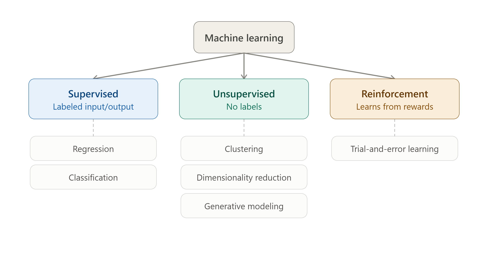

# Machine Learning

Every day you rely on machine learning without noticing it: the filter that quietly moves junk mail out of your inbox, the photo app that groups pictures by who appears in them, the streaming service that lines up the next thing you are likely to watch, and the engine that taught itself to play chess better than any human. Behind each of these is the same core idea — *a system that improves at a task by learning from data rather than by following hand-written rules*.

Machine learning is a subfield of Artificial Intelligence focused on developing algorithms that enable computers to learn from data and to make predictions or decisions based on data.

Machine learning is concerned with the mechanisms and algorithms through which machines can improve their performance on a given task from experience, represented by the data associated with that task.

In recent years, this area has seen an explosive growth and is often colloquially conflated with AI in popular discussion.

The machine learning field can be coarsely divided into three areas:

- Supervised Learning;
- Unsupervised Learning;
- Reinforcement Learning.

{fig-align="center" fig-alt="The different machine learning areas."}

There are a few other kinds of machine learning that are connected to one of these three main areas — self-supervised learning, for example — but those three areas cover most of the current applications of machine learning.

## Supervised Learning

A supervised learning model defines a mapping from one or more inputs to one or more output predictions, based on provided examples of input and output pairs. These input/output pairs take the role of a teacher or a supervisor for the learning process, and this gives rise to the term supervised learning.

Mathematically, we can represent a supervised learning model as a function $f(\mathbf{x})$ that takes an input $\mathbf{x}$ and returns an output $\mathbf{\hat{y}}$:

$$
\mathbf{\hat{y}} = f(\mathbf{x})
$$

Here, boldface indicates a vector, so $\mathbf{x}$ and $\mathbf{\hat{y}}$ may each contain several values, and the hat denotes a **prediction**: $\mathbf{\hat{y}}$ is the model's estimate of the true output $\mathbf{y}$, not the true output itself. The process of computing $\mathbf{\hat{y}}$ from the input $\mathbf{x}$ is called **inference**.

The function $f$ depends on internal **parameters**, usually denoted $\boldsymbol{\theta}$. **Training** (or **learning**) is the process of adjusting these parameters so that the predictions $\mathbf{\hat{y}}$ match the true outputs $\mathbf{y}$ as closely as possible across the provided examples. How close they are is measured by a **loss function**, and training amounts to searching for the parameters that make this loss as small as possible. Once the parameters are fixed, the model can be used for inference on new, unseen inputs.

Supervised learning deals with two kinds of problems: regression problems and classification problems.

### Regression

Regression problems in supervised learning involve predicting the value of an outcome variable based on one or more predictor variables that are represented by the input data to the model. In machine learning, the emphasis is on **prediction**: the model learns from past examples so it can estimate the outcome for new inputs it has not seen before. This differs in emphasis from classical statistics, where regression is often used to **explain** the relationship between a dependent variable and one or more independent variables.

An example of a regression application is to predict the price of a house based on input characteristics such as the square footage, the number of bedrooms, the number of bathrooms, the age of the house, location, and other relevant attributes. In this case a model can learn from historical data of house sales and predict the prices of new listings.

*Table: A handful of training examples for house-price regression. The model learns from rows like these to predict the price of a new house from its area, bedrooms, and age.*

| Area (m²) | Bedrooms | Age (years) | Price (\$1000s) |
|:---------:|:--------:|:-----------:|:---------------:|
| 70        | 2        | 15          | 180             |
| 120       | 3        | 5           | 310             |
| 95        | 2        | 30          | 205             |

Another example is predicting the future demand for products or services based on past sales data, seasonal trends, economic indicators, and other relevant factors in order to improve inventory management, supply chain optimization, and financial planning.

In both examples, we are trying to predict a numerical value from the different predictors.

### Classification

In a classification application, the model returns a category assignment (a label) to the input data.

A classic example of a classification problem is to classify emails as spam or not spam based on input features such as the frequency of certain words, the email sender, the time of day the email was sent, and other relevant features. In this case, since the model attempts to assign the input to one of two categories, this is a **binary classification problem**.

Another example is a model that has a handwritten digit image file as an input and predicts which number is written. This is a **multiclass classification problem**, since there are more than two possible numbers, which are the categories of the problem in this case.

## Unsupervised Learning

Constructing a model from input data without corresponding output labels is termed **unsupervised learning**; the absence of output labels means that there can be no "supervision".

Rather than learning a mapping from input to output, the goal of unsupervised learning is to describe or understand the structure of the data.

Unsupervised learning problems can be divided into three areas:

- Clustering;
- Dimensionality reduction;
- Generative modeling.

### Clustering

Intuitively, clustering is like sorting a pile of unlabeled photographs into groups by resemblance, without being told in advance what those groups should be. Clustering is a fundamental task in unsupervised learning where the goal is to group similar data together based on certain features or characteristics.

For example, in marketing, clustering can be used to group customers based on their purchasing behavior, demographic attributes, or browsing patterns, so that businesses can tailor marketing strategies and product offerings to specific segments, thereby improving customer satisfaction and retention.

### Dimensionality Reduction

Dimensionality reduction is another fundamental problem in unsupervised learning that involves reducing the number of random variables under consideration by obtaining a smaller set of representative variables.

This process is essential for simplifying the analysis, visualization and interpretation of high-dimensional data while preserving its essential structure and characteristics. It also helps in the processing of the data since we are now dealing with a smaller number of features.

### Generative Modeling

Generative modeling is another fundamental problem in unsupervised learning that involves learning the underlying probability distribution of the data in order to produce new samples that resemble the original data. This is closely related to **density estimation**, where the goal is to estimate how likely different data points are under the distribution that generated them.

For example, a generative model can learn from a large collection of images and then synthesize new, realistic images that never appeared in the training set. The same principle allows models to generate coherent text, compose music, or produce synthetic data to augment a dataset when real examples are scarce or expensive to obtain. This area has become one of the most consequential in machine learning in recent years, as it underlies much of the current progress that is now widely associated with the term AI.[^self-supervised]

[^self-supervised]: Traditionally grouped under unsupervised learning, many modern generative models are trained in a *self-supervised* manner, in which the "labels" are derived automatically from the input data itself (for example, predicting the next word in a sentence).

## Reinforcement Learning

Reinforcement learning can be pictured as training a dog with treats: the animal is never told the correct action outright, but gradually learns which behaviors earn rewards by trying things and seeing what follows — and sometimes the treat arrives well after the trick that earned it. Reinforcement Learning is a type of machine learning paradigm concerned with how agents ought to take actions in an environment in order to maximize some notion of cumulative reward. Unlike supervised learning, where the model is trained on labeled data, or unsupervised learning, where the model must find structure in unlabeled data, reinforcement learning is about learning through trial and error interactions with an environment.

In Reinforcement Learning, an agent interacts with an environment by taking actions, receiving feedback in the form of rewards, and updating its knowledge or policy to make better decisions over time.

The goal of reinforcement learning is to find an optimal policy that maximizes the cumulative reward over time, that is, the agent learns to choose actions that lead to higher rewards on average. This is typically done by iteratively updating the agent's policy based on the rewards received from the environment.

One complication is that the reward may occur some time after the action is taken, so associating a reward with an action is not straightforward — much like the dog, the agent cannot easily tell which of its earlier actions earned the reward. This is known as the **temporal credit assignment problem**.

As the agent learns, it must trade off **exploration** and **exploitation** of what it already knows; perhaps the agent has already learned how to receive modest rewards; should it follow this strategy (exploit what it knows), or should it try different actions to see if it can improve (explore other opportunities)?
